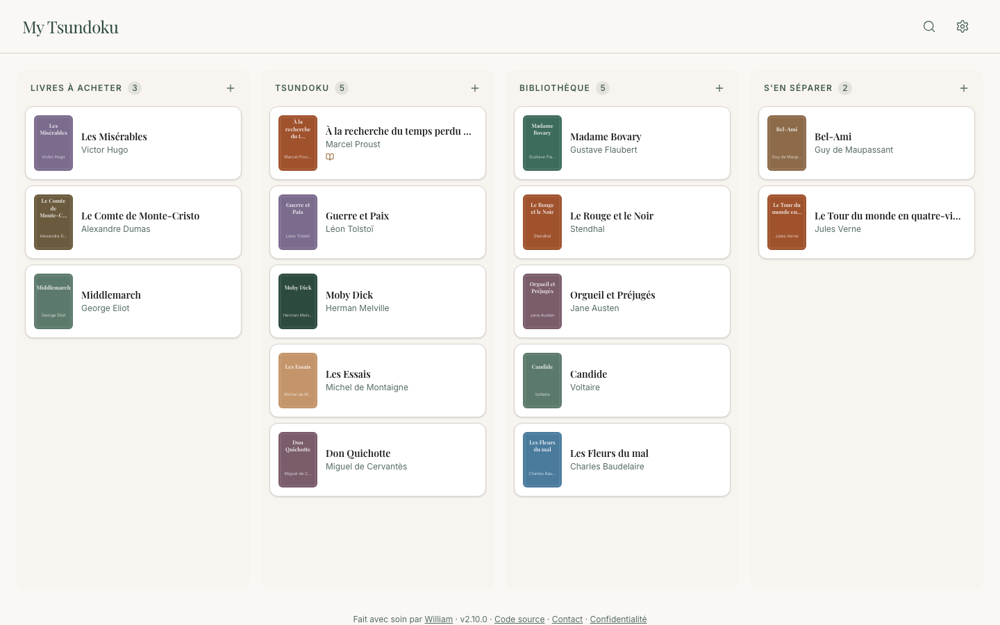

[English](README.md) · **Français**

# My Tsundoku

La pile de livres qu’on n’a pas encore lus, suivie comme une réserve de surprises.

**Statut :** maintenu · public · en libre accès sur **[www.my-tsundoku.app](https://www.my-tsundoku.app)**

<picture>
  <source media="(prefers-color-scheme: dark)" srcset="docs/media/board-fr-dark.png">
  
</picture>

## Pourquoi

Quand je me suis remis à lire régulièrement, j’ai essayé Babelio, mais ça n’a pas tenu, probablement parce que l’application ne correspond pas à la façon dont les livres vivent chez moi. Alors j’ai construit celle-ci, qui suit ce flux : accumulation de livres à acheter → accumulation de livres dans le Tsundoku → accumulation de livres dans la bibliothèque → séparation de certains livres qui n’y méritent pas ou plus leur place. Et je me suis dit que peut-être d’autres amateurs de littérature pourraient tirer profit d’une telle application.

Toute l’histoire, du mot japonais à un livre sur la nuit au Moyen Âge : [My Tsundoku, sur william.revah.paris](https://william.revah.paris/stories/tsundoku/).

## Liens

- L’application : [www.my-tsundoku.app](https://www.my-tsundoku.app)
- Où vont vos données : [Confidentialité](https://www.my-tsundoku.app/confidentialite)
- Une suggestion ? [Écrivez-moi](mailto:contact@my-tsundoku.app)
- Lancer le projet en local, le déployer, la documentation technique : [README en anglais](README.md#run-locally)

Licence [GNU Affero General Public License v3.0](LICENSE) ; licence commerciale possible, sur demande à [w@revah.paris](mailto:w@revah.paris).

---

Fait avec soin par [William](https://william.revah.paris)
