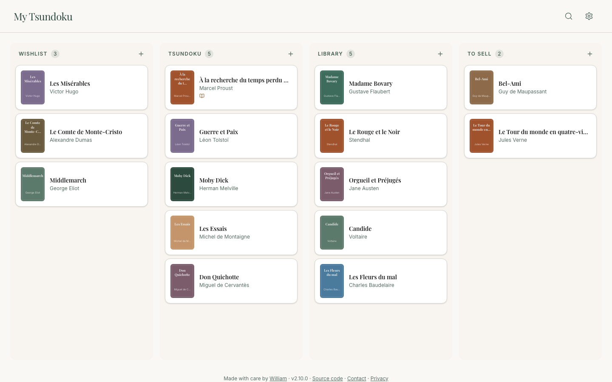
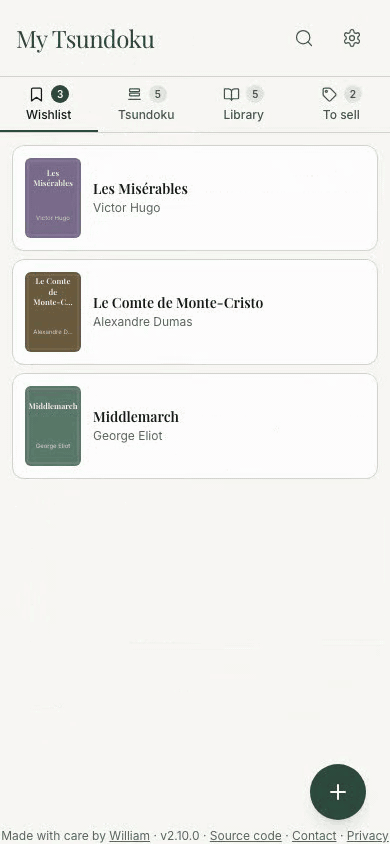
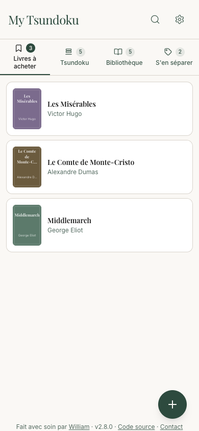
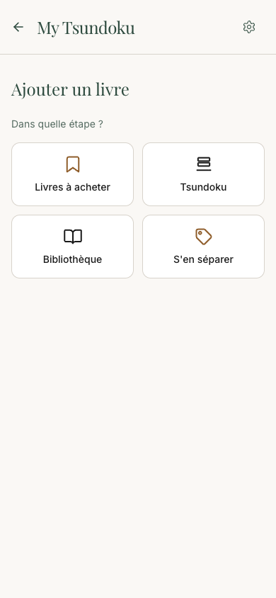

<!-- portfolio
name: "My Tsundoku"
tagline_fr: "Votre tsundoku, de l’envie à la bibliothèque"
tagline_en: "Your tsundoku, from wishlist to library"
about_en: "A bilingual (FR/EN) offline-first PWA for organizing personal book collections on a Kanban board."
facts_fr: "Next.js 16, local-first sur IndexedDB, synchro Supabase, PWA hors ligne."
facts_en: "Next.js 16, local-first on IndexedDB, Supabase sync, offline PWA."
-->

**English** · [Français](README.fr.md)

# My Tsundoku

The stack of books you haven’t read yet, tracked as a reserve of surprises.

**Status:** maintained · public · free to use at **[www.my-tsundoku.app](https://www.my-tsundoku.app/en)**

[](https://github.com/w2ur/my-tsundoku/actions/workflows/ci.yml)
[](https://www.my-tsundoku.app/en)
[](LICENSE)

<picture>
  <source media="(prefers-color-scheme: dark)" srcset="docs/media/board-dark.png">
  
</picture>

## Why

When I started reading regularly again, I tried Babelio, but it didn’t stick, probably because the application doesn’t match the way books live in my home. So I built this one, which follows that flow: books to buy pile up, then they pile up in the Tsundoku, then in the library, and some that do not, or no longer, deserve their place there are let go. And I thought that perhaps other lovers of literature might get something out of it.

The whole story, from the Japanese word to a book on night in the Middle Ages: [My Tsundoku, on william.revah.paris](https://william.revah.paris/en/stories/tsundoku/).

## What it does

- Four piles on a Kanban board: wishlist, Tsundoku (the unread pile), library, and to sell; drag a book from one to the next.
- Add a book by scanning its barcode, searching its title, or typing it in by hand. An ISBN is looked up in Open Library first, then in the BnF catalogue, which covers the French publishing Open Library lacks.
- Installs as an app and works offline. French and English, light and dark mode.
- Export your whole library as a JSON file, with or without an account.

<picture>
  <source media="(prefers-color-scheme: dark)" srcset="docs/media/piles-dark.gif">
  
</picture>

## Where your data lives

Without an account, your books, notes and settings stay in your browser’s own database on your device; nothing from your library leaves it, apart from searches. Scanning an ISBN or searching a title goes straight from your browser to Open Library and, for an ISBN it does not know, to the BnF; a title typed by hand is also looked up in the shared catalogue.

Signing in (a one-time code sent to your e-mail, no password) copies your library to Supabase, in its West EU region, so the same library follows you across devices. When a synced book has no Open Library record, its title, author and ISBN are copied, with no link to your account, into a shared catalogue that helps other readers find it; this is on by default and can be turned off in Settings.

The full notice: [Privacy](https://www.my-tsundoku.app/en/privacy).

## Run locally

```bash
cp .env.example .env.local   # fill in your Supabase credentials
npm install
npm run dev
```

Open [http://localhost:9876](http://localhost:9876). A first visit opens on the landing page; adding a first book, or entering the app, switches the device to the board. Then `npm test` runs the tests and `npm run build` builds the app and its service worker.

## Deploy

Auto-deployed on Vercel on push to `main`. Vercel crons, declared in `vercel.json`, keep the Supabase project awake and delete the cover files of purged books; the database migrations are applied by hand in the Supabase SQL editor. Variables, migration order and retention: [docs/operations.md](docs/operations.md).

## Roadmap

Planned features (in no particular order):

- **Sort your piles** — Order a column by author, title or date added
- **Pile statistics** — See how fast your pile grows, and how long your books have been waiting
- **Find in a bookshop** — Reach the books you mean to buy at your bookshop, in one tap

Have a suggestion? [Get in touch](mailto:contact@my-tsundoku.app).

## Documentation

- [Architecture](docs/architecture.md): tech stack, project structure, the landing page and its screenshots
- [Operations](docs/operations.md): environment variables, migrations, build, deployment, retention
- [CLAUDE.md](CLAUDE.md): the rules an agent working in this repo must follow

The phone screenshots the web app manifest uses, regenerated by `npm run screenshots`:

 

## License

This project is licensed under the [GNU Affero General Public License v3.0](LICENSE).

Commercial licensing available — contact [w@revah.paris](mailto:w@revah.paris).

---

Made with care by [William](https://william.revah.paris)
